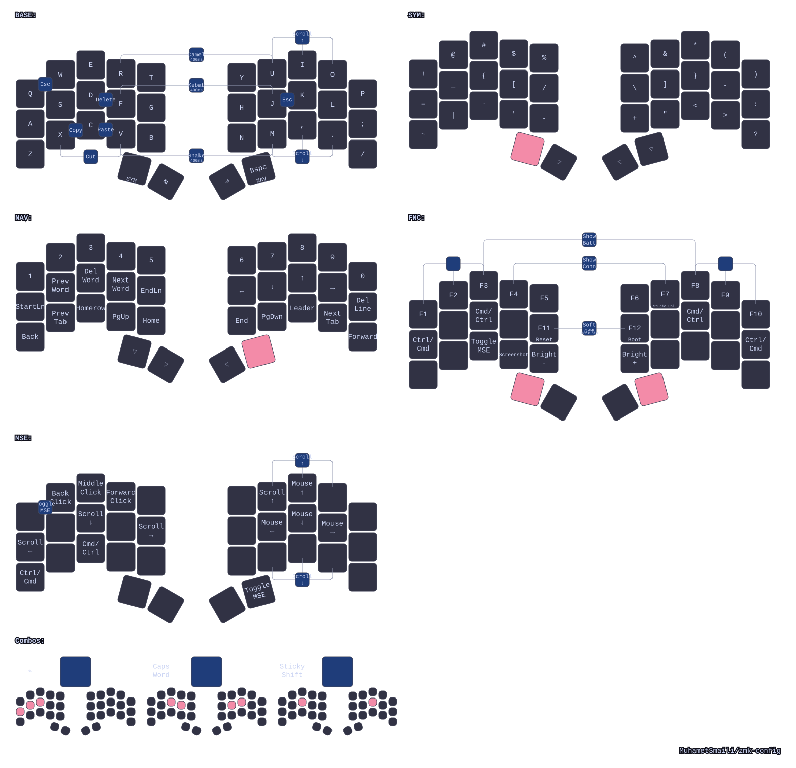

# 34-Key ZMK Layout (Sweep / Urchin / Forager / Toucan)

| [Ferris Sweep](https://github.com/davidphilipbarr/Sweep)                                                                                  | [Urchin](https://github.com/duckyb/urchin)                                                                                          | [Forager](https://github.com/carrefinho/forager)                                                                                              |
| ----------------------------------------------------------------------------------------------------------------------------------------- | ----------------------------------------------------------------------------------------------------------------------------------- | --------------------------------------------------------------------------------------------------------------------------------------------- |
|  |  |  |

This repo contains my personal [ZMK](https://zmk.dev/) layout for Sweep, Urchin, Forager, and a 36-key Toucan2. All four share the same logical 34-key keymap, while `build.yaml` handles the board-specific firmware targets. Toucan2's two extra thumb keys are inactive; its firmware target names remain `toucan_*`.

The goal is not to build the most exotic layout possible. It is a pragmatic 34-key setup that stays close to normal QWERTY, keeps programming symbols easy to reach, and smooths over the annoying differences between Linux and macOS.

## What This Layout Optimizes For

- Familiarity first: I want standard QWERTY muscle memory to transfer well.
- Small-board practicality: thumbs and layers do the heavy lifting instead of stretching for distant keys.
- Programming comfort: common symbols and editing actions are close to home row.
- Cross-device consistency: the same layout works across Sweep, Urchin, Forager, and Toucan.
- Cross-OS consistency: shortcuts and navigation adapt between Linux and macOS.

## Start Here

If you want to understand the repo quickly, read the files in this order:

1. `config/includes/base.dtsi` for the shared layers, system macros, and the main keymap.
2. `config/includes/hold-taps.dtsi` for the shared hold-tap definitions, timing constants, and helper macros.
3. `config/includes/oskey.dtsi` for the Linux/macOS-aware modifiers and navigation helpers.
4. `config/includes/combos.dtsi` for combos.
5. `config/includes/mouse.dtsi` for mouse tuning.
6. `build.yaml` for the actual flash targets.

Notes:

- The Sweep uses the `cradio_*` shield names internally, so some files and generated artifacts still use `cradio`.
- The shared keymap logic lives in `config/includes/`, so changes there apply to all four boards.
- Toucan reuses [my working hardware fork](https://github.com/MuhametSmaili/zmk-keyboard-toucan2), with a local 36-key layout adapter and minimal battery/connection screen.

## Modules and Why I Use Them

This config uses a few external ZMK modules in addition to upstream ZMK itself.

| Module                                                                | Small description                                             | Why I use it here                                                                                                                             |
| --------------------------------------------------------------------- | ------------------------------------------------------------- | --------------------------------------------------------------------------------------------------------------------------------------------- |
| [`zmk-case-mode`](https://github.com/MSmaili/zmk-case-mode)           | Case-mode behavior for typing identifiers with normal spaces. | I use it for `snake_case`, `camelCase`, and `kebab-case` through hold-only combos on `BASE`.                                                  |
| [`oskey`](https://github.com/mentaldesk/oskey)                        | OS-aware key behavior for Linux/macOS shortcut differences.   | I use it for swapped `Ctrl`/`Cmd` home-row mods, word movement, line movement, and delete-word behavior without maintaining separate keymaps. |
| [`zmk-rgbled-widget`](https://github.com/caksoylar/zmk-rgbled-widget) | RGB LED status indicator module.                              | I use it for battery and connection indicators on builds that support an RGB LED.                                                             |
| [`zmk-keyboard-toucan2`](https://github.com/MuhametSmaili/zmk-keyboard-toucan2) | Toucan hardware definitions. | Reuse the working pin assignments and split trackpad routing without copying the hardware module. |
| [`zmk_driver_azoteq`](https://github.com/beekeeb/zmk_driver_azoteq) / [`zmk-input-zoom`](https://github.com/beekeeb/zmk-input-zoom) | TPS43 trackpad driver and zoom processor. | Preserve Toucan's native trackpad gestures. |

## Layer Model

- `BASE`: QWERTY, home-row mods, thumb-layer access, and the main daily typing layer.
- `SYM`: symbols and punctuation placed in familiar QWERTY-style positions.
- `NAV`: numbers on the top row, text navigation and editing on the home row, and global shortcuts on the bottom row.
- `FNC`: function keys, media controls, mouse toggle, and long-press system controls, plus status and OS-selection combos.
- `MSE`: mouse movement, scrolling, clicks, and bottom-row modifiers.

`FNC` is a tri-layer that appears when both `SYM` and `NAV` are active.

System controls are hidden behind holds on function keys, so normal taps still send function keys. Hold `F5` for BLE output or `F6` for USB output for 500 ms (`OUTPUT_HOLD_MS` in `config/includes/hold-taps.dtsi`). Other system actions retain 3-second holds: `F1`–`F4` for Bluetooth profiles 0–3, `F7` for ZMK Studio unlock, `F10` to clear the current Bluetooth profile, `F11` to reset, and `F12` for the bootloader. Holding `F2` intentionally selects the Linux host (Bluetooth profile 1, shown as BT 2) **and** switches OS mode to Linux. Other profile selections leave OS mode unchanged; use the dedicated OS-selection combos when needed.

For Soft Off, hold the `F11`+`F12` combo (base positions `G`+`H`) together for 3 seconds on `FNC`. Brief taps do nothing; the long hold powers off without needing a key release. Volume up/down repeat when held; mute has its own key on `FNC` at the base `M` position.

## Behavior Choices

### Base layer philosophy

- The alpha layout stays intentionally close to standard QWERTY.
- Numbers stay on the top row instead of moving to a more abstract arrangement, and also double as indexed navigation keys.
- Symbols try to preserve familiar positions where possible.
- Vim-style directional movement is kept on the navigation layer, with the bottom row reserved for non-text shortcuts I use often.

### Home-row mods and thumbs

- Home-row mods are tuned with custom hold-tap settings for cleaner tap vs hold behavior.
- The thumbs carry most of the layout: `SYM/SPACE`, `NAV/BSPC`, `TAB`, and `ENTER`.
- This keeps the main typing area simple while still fitting a full daily-driver workflow into 34 keys.

### Editing and utility combos

Combos provide shortcuts without consuming dedicated keys.

Current combos include:

- editing: `Delete`, OS-aware `Cut`, `Copy`, `Paste`
- control: `Escape`, `Enter`, `Caps Word`, sticky shift
- casing: `snake_case`, `kebab-case`, `camelCase` on `BASE`, each with a 400 ms hold
- navigation aid: scroll combos
- utility: `Soft Off`, battery indicator, and connection indicator
- OS switching: dedicated macOS and Linux combos on `FNC`

`FNC` uses the same OS-aware modifier order as `BASE`. Its screenshot key sends `Cmd+Shift+4` on macOS and `PrintScreen` on Linux/Windows.

### NAV Leader shortcut

On `NAV`, the base comma key sends `Ctrl+Alt+Shift+Space` to activate my Hammerspoon leader key. This requires the matching Hammerspoon configuration on the host. It is not a ZMK leader mode.

### Case modes

On `BASE`, hold one of these combos. No layer thumb is needed:

| Combo     | Mode         |
| --------- | ------------ |
| `V` + `M` | `snake_case` |
| `F` + `J` | `kebab-case` |
| `R` + `U` | `camelCase`  |

Press the two combo keys within 45 ms. Hold both until 400 ms after the first press. Then release the combo before typing. Releasing either combo key before the hold completes cancels activation.

A recognized short chord does not activate a case mode, but it still consumes both letters. The hold prevents accidental mode changes, not missing letters from accidental chords.

`R` + `U` on `FNC` still shows connection status. The shared hold duration is `CASE_HOLD_MS` in `config/includes/hold-taps.dtsi`.

### Mouse modifiers

On `MSE`, the base positions `Z`/`X`/`C`/`V` provide plain held modifiers, matching the left home-row modifier order:

| Base position | macOS mode | Windows/Linux mode  |
| ------------- | ---------- | ------------------- |
| `Z`           | Ctrl       | GUI (Windows/Super) |
| `X`           | Option     | Alt                 |
| `C`           | Cmd        | Ctrl                |
| `V`           | Shift      | Shift               |

Hold a modifier while clicking or moving the pointer. These keys have no tap/hold delay. Mouse movement, scrolling, clicks, and exits remain unchanged. The right bottom row stays free for the existing scroll-down combo.

## Build Profiles and Flash Targets

All four keyboards support dongle and dongleless modes.

### Dongle mode

- `<keyboard>_dongle`: flash to the dongle
- `<keyboard>_left_peripheral`: flash to the left half
- `<keyboard>_right`: flash to the right half

### Dongleless mode

- `<keyboard>_left_central`: flash to the left half acting as central
- `<keyboard>_right`: flash to the right half

### Toucan2 36: screen, trackpad and dongle RGB

- `toucan_left_central.uf2`: left half, central, nice!view status screen, USB ZMK Studio.
- `toucan_left_peripheral.uf2`: left half with its screen, connected to the dongle.
- `toucan_right.uf2`: right half, peripheral with TPS43 trackpad.
- `toucan_dongle.uf2`: existing XIAO BLE dongle, central for both halves, USB ZMK Studio.
- All use `xiao_ble//zmk`. Only `toucan_dongle` includes `rgbled_adapter`, using the shared settings in `config/rgbled_adapter.conf`. RGB remains disabled on the halves.
- In dongle mode the right trackpad sends split-input ID **0** to the dongle, which runs the mouse/gesture processors and shared keymap. There is no local trackpad or keyboard GPIO scan on the dongle.
- The fork's default six-column matrix is reduced to five columns in `config/hardware_layouts/toucan.dtsi`, including the matching Studio physical layout.
- The four active thumbs, left to right, are **Space/SYM, Tab/Ctrl, Enter/Shift, Backspace/NAV**. The outermost thumb on each side is inactive.
- Trackpad movement/button activity temporarily enables the Toucan2-only **TPM** left-hand mouse layer. The right hand and every thumb remain transparent; the manually toggled `MSE` layer stays independent.
- Raw finger-contact events are consumed, not sent as a held left click. Ordinary pointer movement must not select text; deliberate single-tap clicks, two-finger right-click and hold-to-drag remain enabled.
- Native tap-to-click, hold-to-drag, two-finger tap/scroll, pinch zoom, and three-finger swipes retain the fork's configuration. `SYM`/`NAV` no longer turn pointer movement into scrolling; use two-finger scrolling on any layer.
- Zoom and swipe shortcuts remain the fork's macOS defaults; the shared OS selector still controls keyboard shortcuts, not these trackpad gestures.
- Toucan uses the same battery/connection indicator combos as the other keyboards. In dongle mode they flash the dongle's built-in RGB LED. The screen still shows both numeric battery readings.
- The **144×168** screen shows only **L/R battery percentages and host connection status**, using standard LVGL labels and fonts. There are no gauges, profile indicators, layer names, WPM or animations. `nice_view` supplies the driver; `toucan_display` supplies the minimal screen.
- In dongle mode, the local relay supplies the other half's battery and host readiness over the existing encrypted split link. L comes from the screen half's own sensor. R comes from the other recipient slot, independent of pairing order. A missing reading shows `--`; a real empty battery shows `0%`.
- Toucan uses the shared **7-minute deep-sleep timeout** and **30-second idle timeout** from `config/default.conf`, like the other keyboards.
- The USB-powered dongle does not enter automatic deep sleep.

For dongle mode, flash `toucan_dongle.uf2`, `toucan_left_peripheral.uf2`, and `toucan_right.uf2`. For dongleless mode, flash `toucan_left_central.uf2` and `toucan_right.uf2`.

Changing which device is central changes the split Bluetooth topology. Clear the saved settings on the dongle and both halves using `settings_reset_xiao_ble.uf2`, then flash the matching normal firmware to each device. This erases saved bonds/settings; remove the old host Bluetooth pairing and pair the new central again if using Bluetooth. Do not flash one keyboard's dongle firmware expecting it to serve multiple keyboards simultaneously. If Studio has saved a custom layout, restore its default keymap to use these firmware bindings. Hardware behavior still needs verification after flashing.

The setup follows [ZMK's dongle guide](https://zmk.dev/docs/hardware-integration/dongle) and [split-pointing integration](https://zmk.dev/docs/hardware-integration/pointing). The local left-peripheral shield preserves the fork's pin assignments without inheriting its left-central-only battery defaults.

#### Automatic left-hand mouse layer (TPM)

After 200 ms without typing, trackpad activity enables TPM until 1 second of trackpad inactivity. Touching the pad without movement or a real button gesture does not activate it. A normal typing key or any thumb cancels TPM immediately; the mouse-action keys below do not cancel it. `SYM`, `NAV`, `FNC`, and manually enabled `MSE` bypass automatic activation.

| Base positions | While TPM is active |
| --- | --- |
| `W` / `E` / `R` | Back / middle / forward mouse buttons |
| `F` / `S` | Left / right mouse button |
| `A` / `D` / `G` | Scroll left / down / right |
| `Z` / `X` / `C` / `V` | OS-aware outer modifier / Alt / OS-aware inner modifier / Shift, like `MSE` |

This click order applies only to TPM. Manual `MSE` keeps `S` as left click and `F` as right click.

All other keys keep their underlying bindings. Tune the timeout, typing guard, and bindings in `config/includes/toucan-mouse.dtsi`. The input routing/filter lives in `config/includes/toucan-pointing.dtsi`. Both connection modes use the same configuration; other keyboards do not gain this layer.

For the contact-click fix and TPM in **dongle mode**, update `toucan_dongle.uf2`; in **dongleless mode**, update `toucan_left_central.uf2`. No Bluetooth settings reset is needed when keeping the same topology. If Studio has saved an old custom keymap, restore the firmware default keymap so the new TPM layer is present.

#### Screen and connection status

The screen shows `L: 73%`, `R: 41%` and one of these host labels (numbers are examples):

| Label | Meaning |
| --- | --- |
| `HOST USB` | The central selected a ready USB keyboard connection. USB power alone is not enough. |
| `HOST BLE` | The central selected a connected Bluetooth host. |
| `NO HOST` | Status is available, but the central has no ready host connection. |
| `STATUS ?` | The screen has no fresh central status. This is not proof that typing is disconnected. |

A missing or disconnected right battery shows `R: --`. The screen keeps its local L reading even when remote status is unavailable. In dongleless mode, the left central reads status directly without a relay.

The Toucan-only relay sends battery/output frames on change, with a five-second refresh per connected recipient. It sends at most one frame per 250 ms and skips an occupied BLE command queue. Layer and profile-number changes no longer generate screen traffic. Actual key layers, profile switching and TPM behavior are unchanged.

The receiver invalidates remote status on disconnect or after 15 seconds without a valid state frame. It ignores obsolete layer-name frames. Both halves still receive status because pairing slots do not identify the screen; the screenless right receiver ignores it.

The queue guard is best-effort and uses an internal ZMK transport symbol. A future ZMK update can require an integration change. The status source remains local for now; module extraction is a separate step.

#### Dongle RGB feedback

On `FNC`, press **E + I** for battery feedback or **R + U** for connection feedback (base key positions). The dongle uses the existing RGB widget; its battery flashes refer to the halves in pairing-slot order, not guaranteed L/R order. USB-priority feedback uses cyan. Layer-colour indication stays disabled.

RGB is supplementary: the widget treats 0% as missing, while the numeric screen still distinguishes a real 0% from an unknown reading. The halves accept the shared indicator commands without driving their LEDs. In dongleless mode these combos have no LED output; the screen remains available.

To install this RGB update, flash the new `toucan_dongle.uf2`, `toucan_left_peripheral.uf2` and `toucan_right.uf2` from `build/local/`. All parts should have the shared indicator behaviors. No settings reset is needed when keeping the same topology.

#### Power and tuning

Only changed labels redraw. The UI task still checks every 250 ms. This is not the total hardware wakeup rate: the inherited Sharp driver also performs serial VCOM maintenance with a 33 ms interval. That interval is unchanged and must not be adjusted without the exact panel requirements.

WPM stays disabled. The halves retain seven-minute deep sleep, 30-second idle and +8 dBm radio power. Idle display blanking remains disabled. The USB dongle stays awake. No measured battery-life improvement is claimed.

Trackpad-only scroll divisor remains **40** in `config/includes/toucan-pointing.dtsi`. Increase it for slower scrolling; decrease it for faster scrolling. Pointer speed, gestures, keyboard scrolling and automatic TPM are unchanged.

#### Flashing this screen simplification

From `build/local/`, update:

- **Dongle mode:** `toucan_dongle.uf2` and `toucan_left_peripheral.uf2`.
- **Dongleless mode:** `toucan_left_central.uf2`.

For the screen-only change, the right half can retain its working status-capable firmware. For the subsequent RGB update, update all three dongle-mode devices as described above. Neither change requires a settings reset or Studio keymap reset when keeping the same topology.

The state frame retains its battery byte and USB/BLE flags. The new receiver accepts older state frames but ignores their extra information. Update the dongle and screen together for the simplified display and reduced traffic.

#### Where to look

- Personal input settings: `config/includes/toucan-mouse.dtsi` and `toucan-pointing.dtsi`.
- Screen labels: `boards/shields/toucan_display/screen.c`.
- Battery/host state and relay: `src/toucan_status.c`, with its small state/wire definition in `include/zmk/toucan_status.h`.
- Host and real-LVGL regression checks: [`tests/toucan-status/README.md`](tests/toucan-status/README.md).

## CI vs Local Builds

### CI

GitHub Actions builds the full matrix from `build.yaml`, including all boards and both dongle and dongleless profiles.

### Local Docker

Use local Docker when iterating on one board.

- `make build KEYBOARD=<sweep|urchin|forager|toucan>` builds a single board in dongleless mode
- `make build KEYBOARD=<sweep|urchin|forager|toucan> DONGLE=1` builds the dongle profile set
- `make draw KEYBOARD=<sweep|urchin|forager|toucan>` regenerates the keymap drawing
- Docker must be running first

```sh
make help

make build KEYBOARD=sweep
make build KEYBOARD=urchin
make build KEYBOARD=urchin DONGLE=1
make build KEYBOARD=forager
make build KEYBOARD=toucan
make build KEYBOARD=toucan DONGLE=1

make draw KEYBOARD=sweep
make draw KEYBOARD=urchin
make draw KEYBOARD=forager
make draw KEYBOARD=toucan
```

Build notes:

- Local firmware builds read `build.yaml` directly, so local and CI targets stay aligned.
- Firmware outputs are written to `build/local/`.
- Keymap-drawer outputs are written to `tools/keymap-drawer/`.
- The first keymap draw builds a pinned local Docker image for keymap-drawer.

## Layer Map

<p align="center">

</p>

## Credits

- [urob/zmk-config](https://github.com/urob/zmk-config) for home-row mod philosophy and layout ideas
- [caksoylar/zmk-config](https://github.com/caksoylar/zmk-config) for layout structure and keymap-drawer integration
